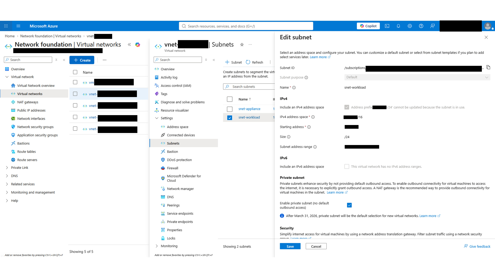
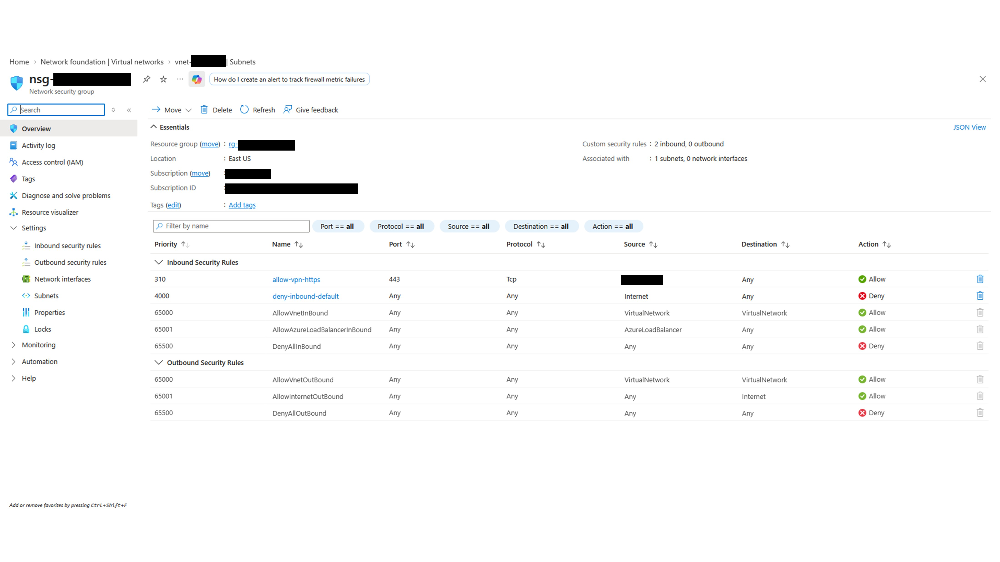
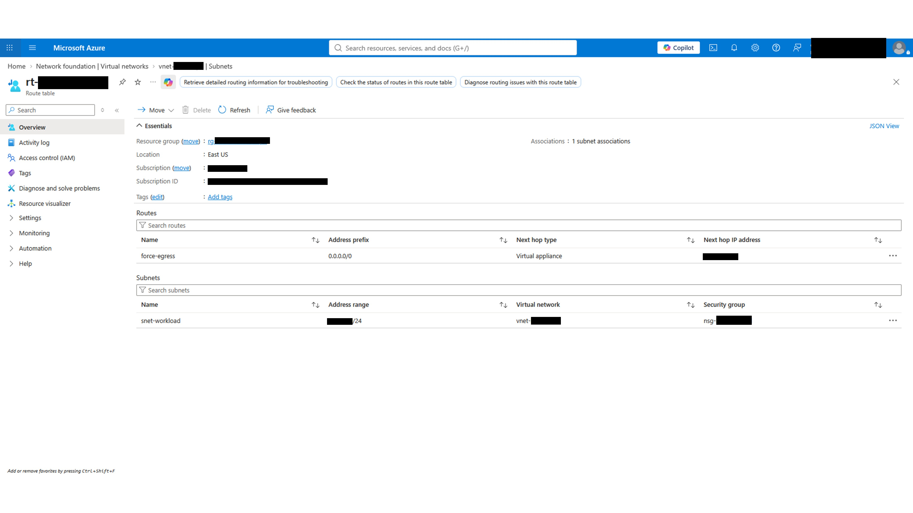
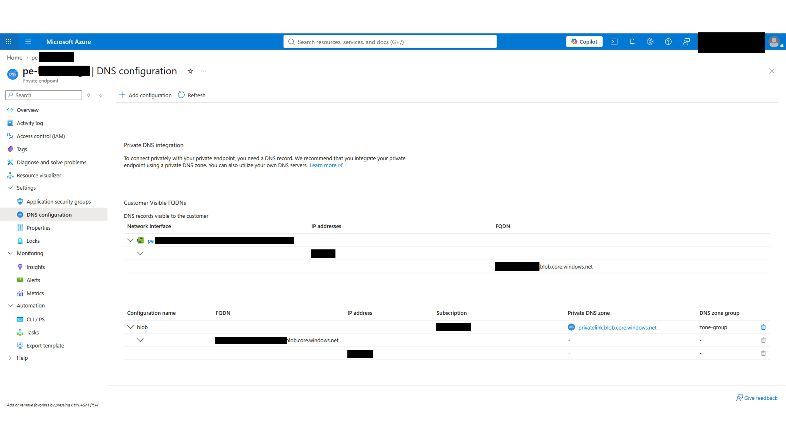
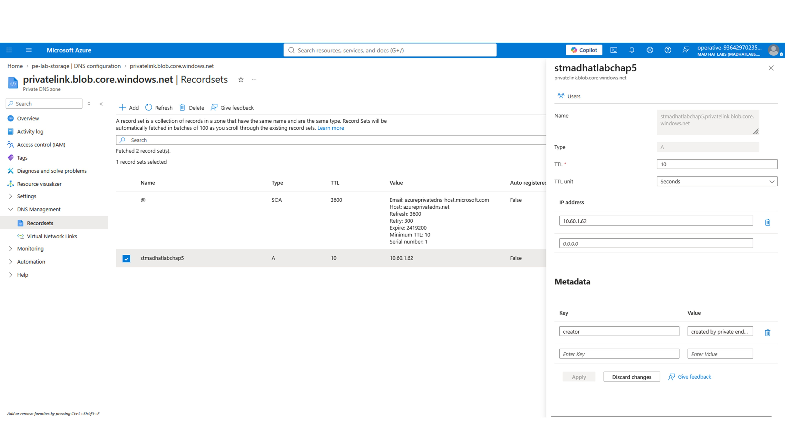
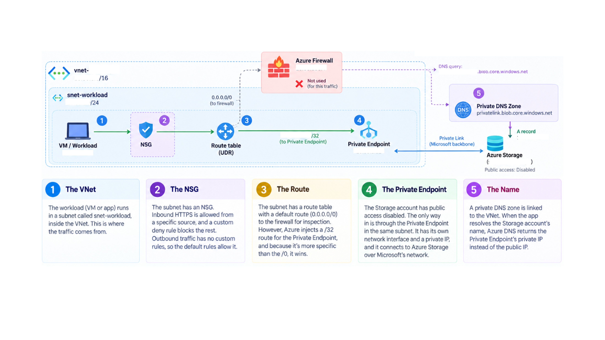

# Network the Operative

## Scenario
Ticket from the app team: "Our new service can reach the customer-data storage account, but I don't understand why or how. Can someone walk me through the network path?"

The current write-up is a hop-by-hop walkthrough from the workload subnet where the app runs to the storage account it ends up talking to.

## Environment

**Azure Cloud**
Ticket: Review the subnet hop-by-hop

Services/tools: Microsoft Entra ID, resource groups, IP address, DNS, and networking (Private endpoints).

Environment: live multi-user Azure training tenant.

Status: Configuration Review in Progress.

Clearance: Operative (Reader access)

## Walkthrough for the app team members.

After receiving the ticket requesting support, a carefully explained walkthrough is planned out.

The packet path is as follows:

1. VNet -> 2. NSG -> 3. Route -> 4. Private Endpoint -> 5. DNS name

What does each section do?

1. Where the workload lives. -> 2. Filters at the subnet edge. Who is actually allowed in?
-> 3. Where the route table says packets go next, and why it is ignored in this case. -> 4. The bridge that pulls the PaaS service into the VNet. -> 5. DNS record.

**Hop 1: The VNet** 
Where does the traffic come from?
The workload runs in a subnet called snet-workload, which lives inside the VNet. The address is *.*.*.*/24 in CIDR notation.

**Hop 2: The NSG**  
The network has an NSG with a default allow-by-exception posture. In the inbound rules there is a pattern: a custom allow rule near the top and a custom catch-all deny near the bottom.

The network team scoped inbound HTTPS to a single source on port 443, and the same pattern applies to outbound traffic; there are no custom rules.

**Hop 3: The Route** 
Where do packets leaving this subnet go? 
The subnet has a route table attached, and it carries a single user-defined route, 0.0.0.0/0, pointed at a virtual appliance for inspection in a forced tunnel.

The next hop is a /32 route to a single address.

**Hop 4: The private endpoint** 
The storage account has public network access disabled from the internet. The only way in is through the private endpoint sitting in the workload subnet with its own NIC and its own private IP, and an address in the same subnet range as hop 1.

The longest prefix gets priority. A /0 is loosely defined because it contains over 4 billion addresses. A /32 contains only one address because each octet in the IP address is a fixed number.

| Prefix | Free Bits | Addresses |
|---|-----|---|
|/0 | 32 | 4,294,967,296 |
|/16| 16 | 65,536 |
|/24| 8 | 256 |
|/28| 4 | 16 |
|/30| 2 | 4 |
|/32| 0 | 1 |

The NIC is in the same subnet. That is why the appliance never sees this traffic. The /32 route has priority over the appliance route at /0, so the traffic never passes through the forced-tunnel appliance to the intended /32 address.

**Hop 5: The DNS name** 
When a private endpoint is configured correctly, a private DNS zone answers for the storage account's Private Link name and hands back the private IP instead of the public IP. Opening the private DNS zone and looking at its record sets under DNS Management, there is an A record for the storage account pointing to the IP found on hop 4.

## The answer to the app team
In short, the app asks Azure DNS for the storage FQDN. Azure DNS queries a private DNS zone, which answers with a private IP belonging to an endpoint inside the same subnet. Once the private IP is received, the traffic moves toward the resolved IP and is subject to the NSG rules. The current default outbound rules allow it. The endpoint's /32 prefix is injected, and the traffic moves across Azure's backbone because the /32 route outranks the /0 forced-tunnel route, so the firewall never sees it.

Here's a diagram:

## What surprised me
This analysis was made with only reader access and nothing else. At first, the path might not seem intuitive, but it reveals step by step the configuration of a typical Azure VNet and how the longest-prefix rule works in practice.

## Findings and recommendations
This small analysis raises the question of whether this behavior was intended or not. If all traffic is supposed to be inspected by the appliance, a new UDR needs to be put in place.

## What I learned
1. The longest prefix wins.
2. System-assigned routes need to be taken into account.