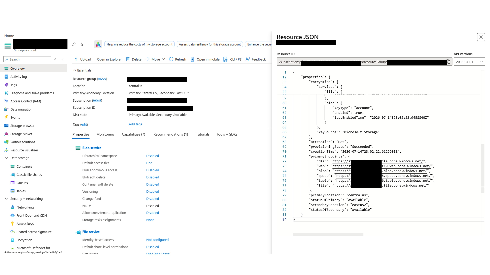
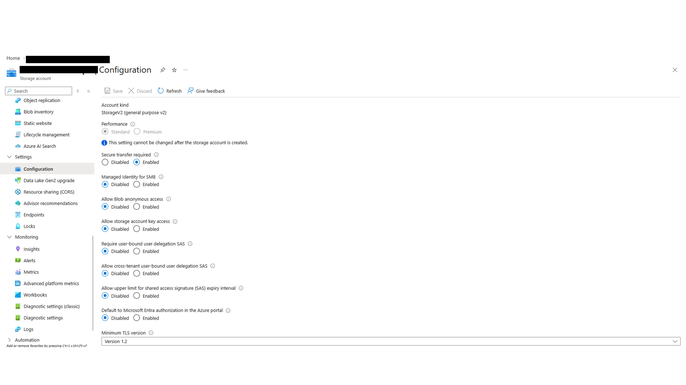
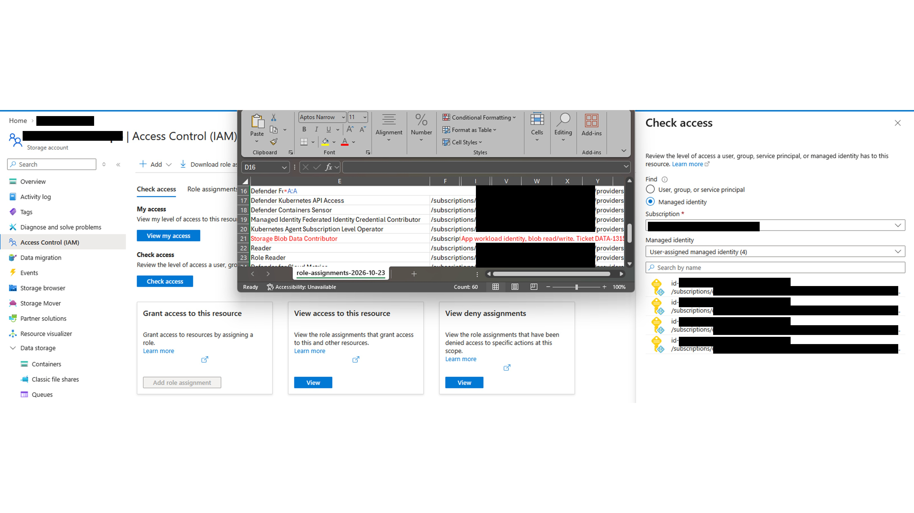
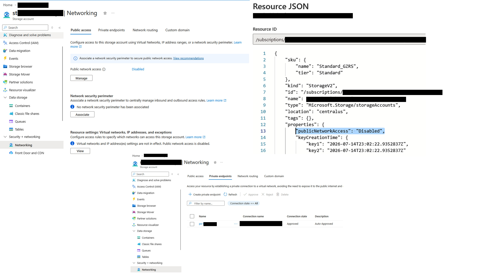
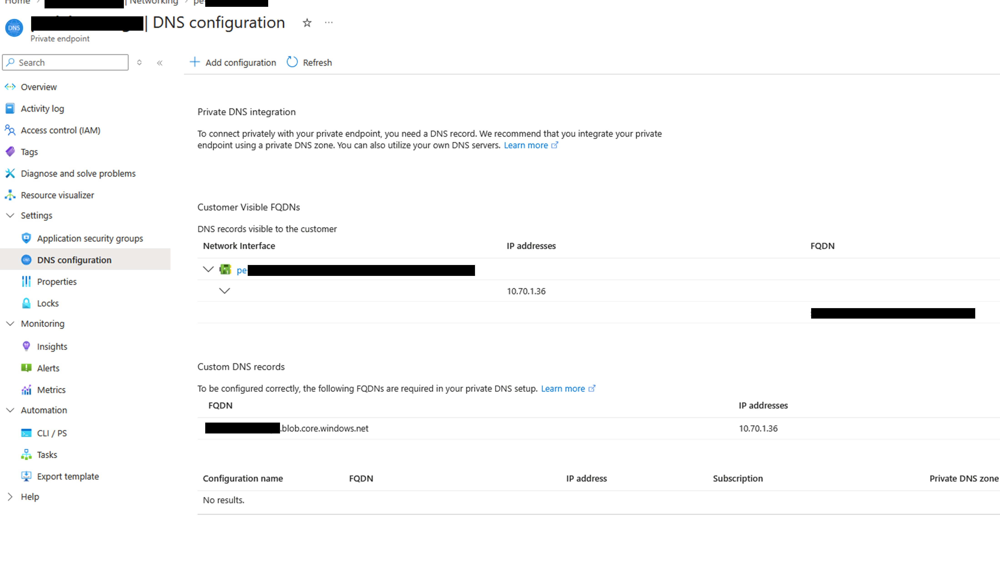
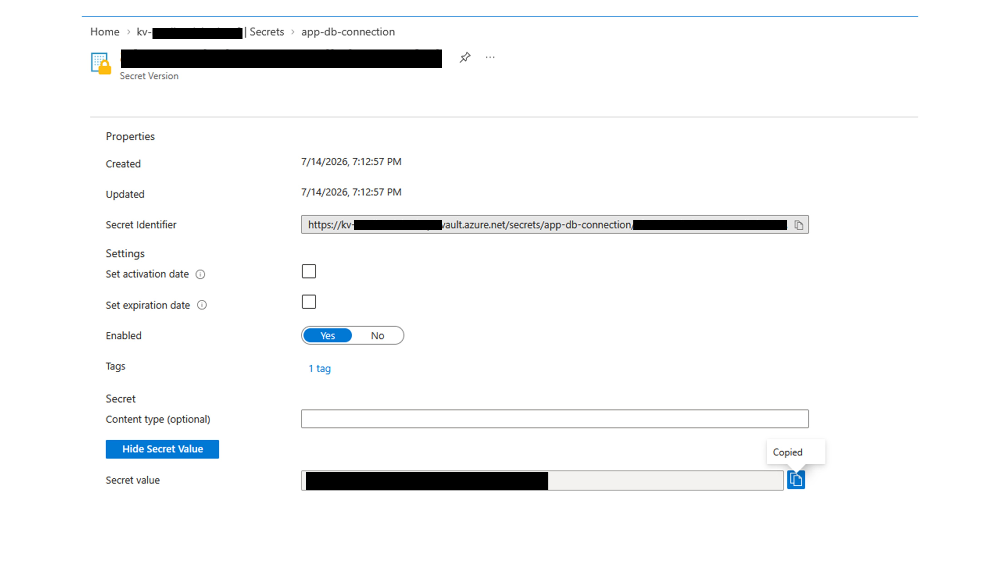
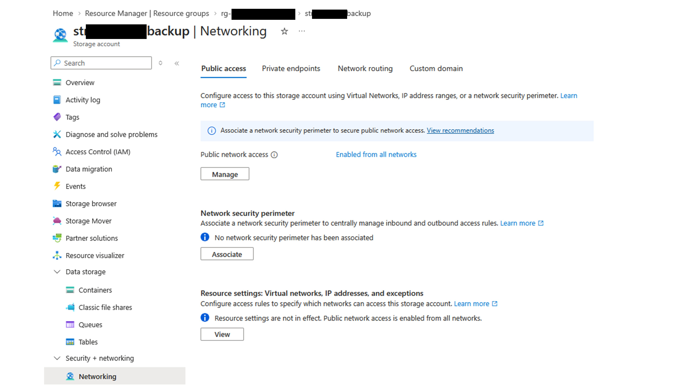
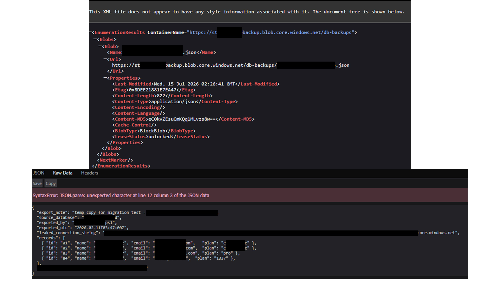

# Bucket Looting

## Scenario
A developer opened a ticket requesting an investigation into how an application accesses customer data.

The application reads a connection string from a Key Vault secret, but the real question is the full flow behind that secret: from the storage account that contains the data, to how it is exposed on the network, back to the vault where the secret is stored, and finally to the actual secret value itself.

## Environment
**Azure Cloud**

- Services and tools: Entra ID, Azure Storage, Key Vault, Managed Identities, Azure RBAC, Virtual Networks, and Private Endpoints
- Scope: live multi-user Azure training tenant
- Access level: operational investigation with limited administrative permissions

## Investigation
The service has existed for some time and reads a database connection string from Key Vault at startup. However, no one has ever traced what that secret actually points to. The goal is to answer three questions:

- What is the app really accessing?
- How is it reachable?
- Is any of it exposed on the public internet?

Path: 1. Data → 2. Key posture → 3. Network → 4. Secret → 5. Findings

### Step 1: The data
I started by examining the storage account associated with the application's connection string. The Blob service endpoint provided a hostname that could be correlated with the application's configuration and related Azure resources. This established the primary storage account as the starting point for investigating how the application reaches its data.

### Step 2: Key posture
The next step was to examine the storage account's authentication posture.

The configuration showed that Shared Key authorization was disabled.

This is an important security control because it prevents requests from authenticating with storage account keys and blocks Shared Key-based SAS authorization.

However, disabling Shared Key does not automatically disable anonymous Blob access or eliminate every other authorization method.

The configuration shows that identity is the only way in. I then reviewed the storage account's Access Control (IAM) configuration to identify the role assignments associated with the application's managed identity. Data access requires an appropriate data-plane role, such as Storage Blob Data Reader or Storage Blob Data Contributor, or another supported authorization mechanism. Storage Blob Data Contributor means it is allowed to read and write.

### Step 3: The network
In the Networking blade, Public Network Access is disabled, as shown in the JSON resource as well. This configuration is designed to restrict access through Azure private networking rather than expose the storage service through its public endpoint.

A Private Endpoint provides a private IP address within a Virtual Network. Applications can reach the storage service through this endpoint when DNS resolution, routing, and network connectivity are configured correctly.

The approved endpoint and disabled public access provided evidence of a restricted network configuration.

### Step 4: The secret
After examining the storage account, the next step was to investigate the secret referenced by the application. The application follows the same path as this operational investigation account.

The application uses a managed identity to authenticate to Key Vault through Microsoft Entra ID.

Key Vault then evaluates the identity's authorization and, if permitted, returns the requested secret through its data plane.

This separates two important operations:

1. Authenticating the application and authorizing access to the secret.
2. Using the retrieved configuration to establish access to the underlying storage resource.

### Conclusions
The connection string stored in the vault points to a storage account with shared-key access disabled, public network access disabled, and accessibility limited to a private endpoint on a VNet. The application is not exposed in a way that raises concern.

### Step 5: Findings
While investigating the original storage account, a second storage account associated with backup data was identified. This resource was outside the original focus of the ticket, but its security configuration warranted further examination.

Unlike the primary storage account, the backup account had:

- Public Network Access enabled
- Blob anonymous access permitted at the storage-account level
- A potentially broader exposure surface than the primary resource

Inspecting the public address:

Exposed info:

## What surprised me
The original ticket was focused on tracing an application's connection string.

However, following the resource relationships revealed a second storage account with a significantly different security posture. This is a clear reminder of why it is important to stay vigilant even when the stated task appears narrow.

## Findings and recommendations
- Container publicly exposed
- Leaked or guessable address
- No login required to read the data

Recommendations:
- Restrict anonymous access
- Review network restrictions
- Validate the authentication flow

## What I learned
This investigation reinforced two important lessons:

- Authentication, authorization, and network access are separate security layers.
- The investigation scope should guide the work, not limit security awareness. Understanding how resources depend on one another can reveal risks that would otherwise remain unnoticed.
