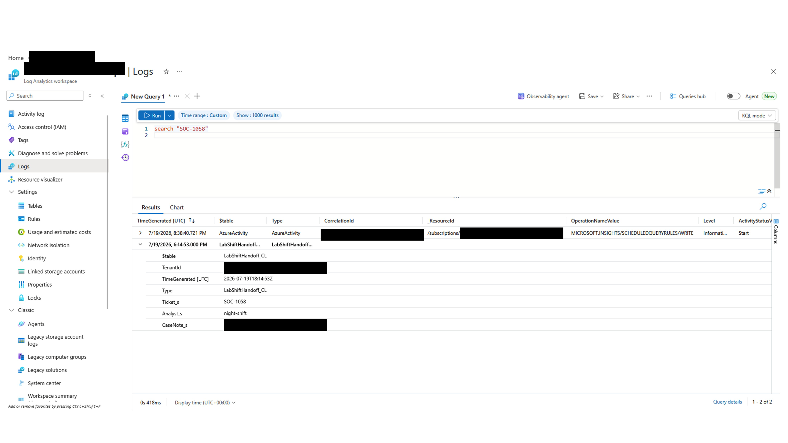
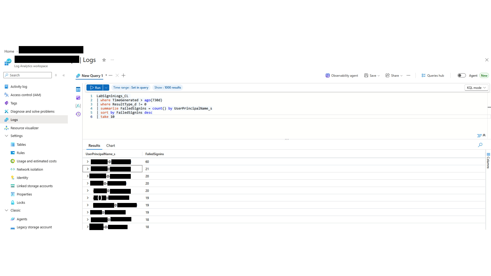
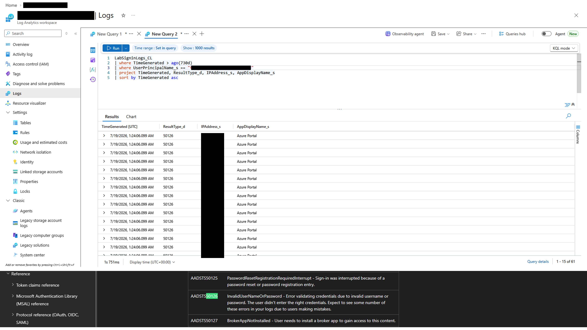
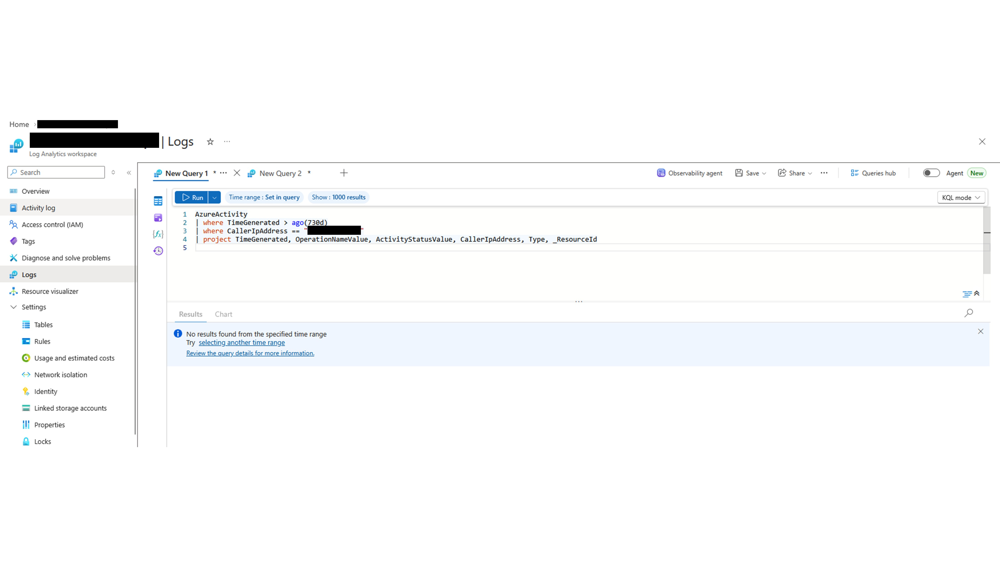
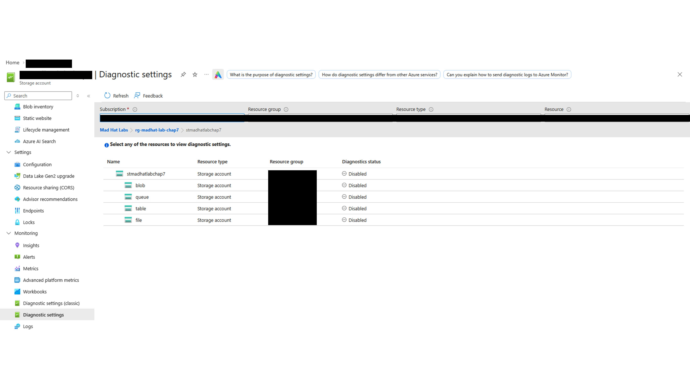
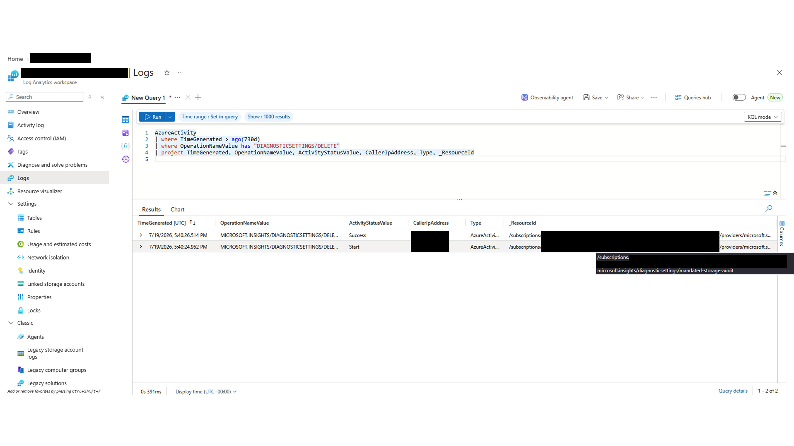
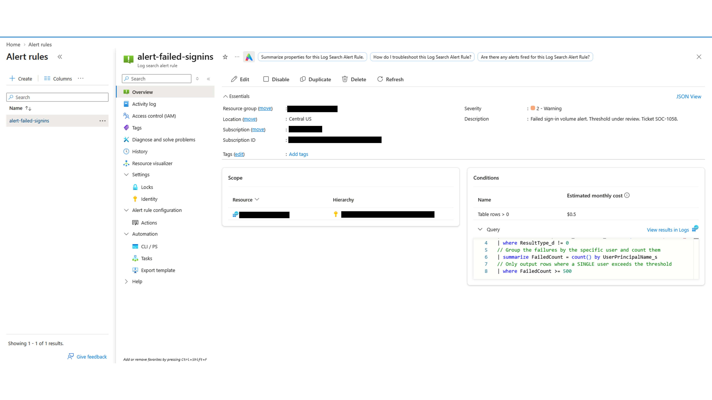
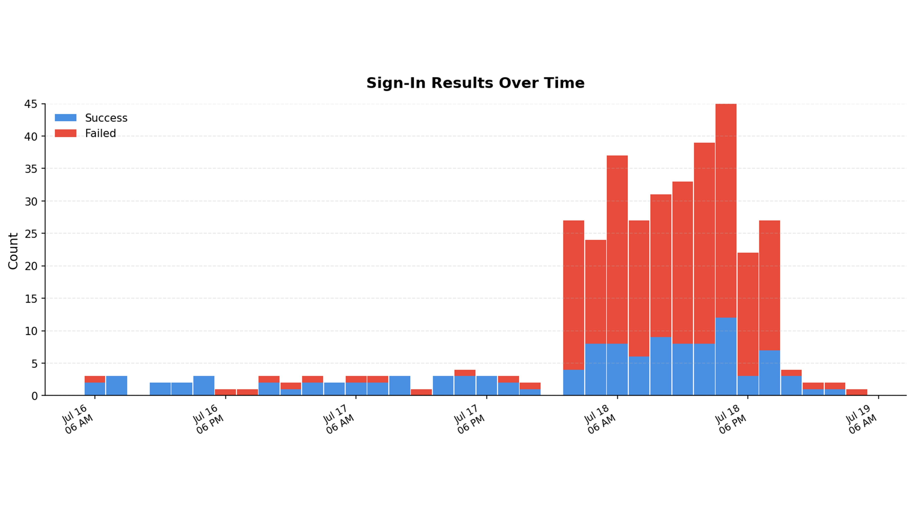

# Find the Anomaly

## Scenario
The SOC team provided ticket SOC-1058 along with a Log Analytics workspace preloaded with a week of simulated sign-in data, audit events, and resource activity. One account shows unusual activity.

**Strategy:** Write KQL queries to surface the anomaly and reconstruct what happened.

## Environment
**Azure Cloud**

- Services and tools: Entra ID, Azure Storage, Key Vault, Managed Identities, Azure RBAC, Virtual Networks, and Private Endpoints
- Scope: live multi-user Azure training tenant
- Access level: operational investigation with limited administrative permissions

## Investigation
### Step 1: Orient
The SOC ticket (SOC-1058) contains little detail. It only reports suspicious activity from an account in the workspace. Start by reviewing the night-shift handoff and searching globally for the flagged item.

### Step 2: The hunt
After locating the ticket, an inspection of the sign-in logs reveals failures across several users. One account stands out: it had over 50 sign-in attempts in the past hour from an unfamiliar IP address, beginning at 01:24 (outside business hours).

The logs also show one successful sign-in. The next image includes a reference for Entra ID sign-in error codes, which are documented by Microsoft.

### Step 3: Gap check
With a successful sign-in by the suspicious user confirmed, the next step is to check AzureActivity using the source IP address to see whether it was used to access or change other resources. No matching records were found.

Next, review the configuration in the Diagnostic settings blade. All diagnostic settings appear to be disabled. This may indicate a defense-evasion technique (MITRE ATT&CK T1685: Defense Impairment).

To determine whether this was deliberate rather than a misconfiguration, query the Log Analytics workspace for a `DIAGNOSTICSETTINGS/DELETE` record.

Risks associated with the deletion include:

1. Silent data exfiltration
2. Undetected data tampering
3. Loss of caller IP addresses
4. Increased risk of authentication abuse

### Step 4: The alert gap
The team did not receive an alert for the failed sign-ins. The `alert-failed-signins` rule has a threshold of 500 attempts per hour, while this scenario involved 50 attempts.

The threshold should be tuned more precisely.

### Step 5: Visualizing the anomaly
Alert rules with thresholds that are too high or poorly tuned may fail to fire even though the data is still being logged.

A workbook can help visualize these records over time by using reusable queries. The image below shows a simplified chart.

## What broke
The ticket provided little information, but the issue can still be investigated with the right skills. KQL queries in Log Analytics make it easier to analyze ingested data. However, data ingestion is opt-in; if it is disabled, there is no data to analyze.

## Findings and recommendations
| Finding | Severity | Remediation |
|---|---|---|
| Logging disabled | High | Re-enable logging. This will not recover missing historical logs, but it will provide data for future investigations. |
| No logging enforcement | Medium | Use Azure Policy to deploy diagnostic settings automatically and flag missing settings as non-compliant. |
| No alert for diagnostic-setting deletion | Medium | Create an Activity Log alert for diagnostic-setting deletion events. |
| Alert threshold too high | High | Refine the threshold so the alert can fire for activity that meets the detection requirements. |
